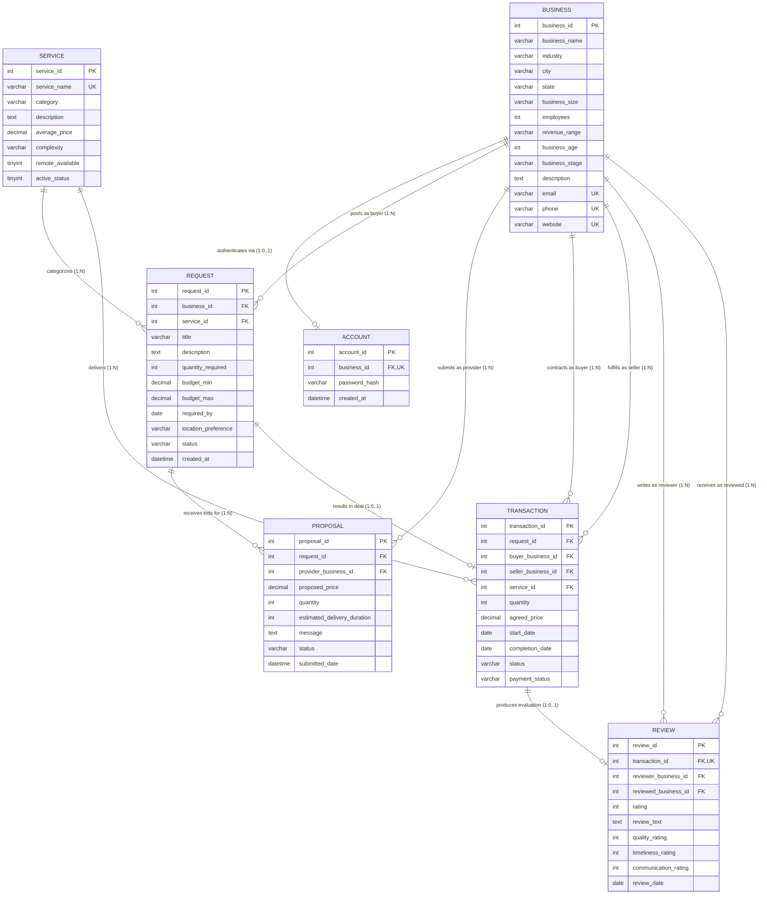

# ServicePath AI - DBMS Practical Demonstration
## ASSIGNMENT 2: Entity-Relationship (ER) Modeling & Normalization Analysis

**Target Database**: `business_service_db`  
**Demonstration Tools**: MySQL Workbench (Reverse Engineering & EER Diagram Canvas) & Mermaid  
**Author**: ServicePath AI Engineering Team

---

## 1. Executive Summary & Domain Context

ServicePath AI is an enterprise B2B service exchange platform connecting corporate buyers with specialized service providers. The relational model coordinates service catalog discovery, request tendering, competitive proposal bidding, binding transactions, escrow payments, and performance ratings.

This document provides:
1. Complete **Entity-Relationship (ER) Diagram** in standard Crow's Foot notation.
2. Step-by-step instructions for **visualizing and exporting the EER Diagram in MySQL Workbench**.
3. Systematic **Entity & Attribute Classification** (Strong, Weak, Composite, Derived, Multivalued).
4. Rigorous **Normalization Analysis** with functional dependency proofs up to **Boyce-Codd Normal Form (BCNF)**.

---

## 2. Complete Entity-Relationship (ER) Diagram

The diagram below reflects the production tables, primary keys, foreign keys, and cardinalities in `business_service_db`.

---

## 3. How to View and Export the Diagram in MySQL Workbench

MySQL Workbench has a built-in Reverse Engineering engine that parses relational catalogs and auto-generates interactive Enhanced Entity-Relationship (EER) diagrams.

### Step-by-Step Instructions:
1. **Open MySQL Workbench** on your workstation.
2. In the top menu, navigate to **`Database`** $\rightarrow$ **`Reverse Engineer...`** (or press `Ctrl + R`).
3. **Set Connection Parameters**:
   - Stored Connection: Local connection.
   - Hostname: `127.0.0.1`
   - Port: `3307` (Dolt server) or `3306` (standard MySQL).
   - Username: `root`
   - Click **`Next >`**.
4. Workbench will connect to the server and retrieve database tasks. Click **`Next >`**.
5. **Select Schema**:
   - Check the checkbox for `business_service_db`.
   - Click **`Next >`**.
6. **Object Selection**:
   - Select **Import MySQL Table Objects** (all 7 core tables: `account`, `business`, `proposal`, `request`, `review`, `service`, `transaction`).
   - Click **`Execute >`** and then **`Finish`**.
7. **View and Arrange Canvas**:
   - Workbench opens the **EER Diagram Canvas** (`.mwb`).
   - Tables and relationship lines are automatically drawn with foreign key connectors.
   - You can drag and position entities logically (e.g. `business` in center, `request` and `proposal` on left, `transaction` and `review` on right).
8. **Export for Viva Presentation**:
   - In the top menu, select **`File`** $\rightarrow$ **`Export`** $\rightarrow$ **`Export as PNG...`** (or `Export as PDF...` / `Export as SVG...`).
   - Save the rendered diagram as `ServicePath_AI_EER_Diagram.png`.

---

## 4. Entity & Relationship Classification

| Entity Name | Entity Type | Primary Key | Business Meaning |
|---|---|---|---|
| **`business`** | **Strong Entity** | `business_id` | Represents registered commercial organizations (buyers and sellers). Independent existence. |
| **`service`** | **Strong Entity** | `service_id` | Standard marketplace catalog of professional service offerings. Independent existence. |
| **`account`** | **Weak Entity** (Subordinate) | `account_id` | Authentication credential vault. Dependent upon existence of parent `business` (`1:1`). |
| **`request`** | **Associative / Relational Entity** | `request_id` | Connects a buyer `business` to a required `service` offering with custom specifications. |
| **`proposal`** | **Associative Entity** | `proposal_id` | Connects a provider `business` with an open `request`. Governed by unique composite rule `(request_id, provider_business_id)`. |
| **`transaction`** | **Associative Entity** | `transaction_id` | Legally binding contract between buyer `business`, seller `business`, `service`, and `request`. |
| **`review`** | **Dependent Entity** | `review_id` | Post-fulfillment evaluation. Linked 1:1 with `transaction` (`transaction_id` unique). |

---

## 5. Detailed Cardinality & Multiplicity Mapping

| Parent Entity | Child Entity | Relationship Name | Cardinality | Multiplicity Ratio | Enforced Constraint / Rule |
|---|---|---|---|---|---|
| `business` | `account` | *authenticates* | **1 : (0..1)** | One-to-One (Optional) | `UNIQUE KEY (business_id)` in `account`. |
| `business` | `request` | *posts request* | **1 : N** | One-to-Many | `request.business_id` FK references `business`. |
| `service` | `request` | *categorizes* | **1 : N** | One-to-Many | `request.service_id` FK references `service`. |
| `business` | `proposal` | *bids on* | **1 : N** | One-to-Many | `proposal.provider_business_id` FK references `business`. |
| `request` | `proposal` | *receives* | **1 : N** | One-to-Many | `UNIQUE (request_id, provider_business_id)` prevents duplicate bids. |
| `request` | `transaction` | *converts to* | **1 : (0..1)** | One-to-One (Optional) | An accepted request produces exactly 1 binding transaction. |
| `business` (Buyer) | `transaction` | *contracts* | **1 : N** | One-to-Many | `transaction.buyer_business_id` FK references `business`. |
| `business` (Seller) | `transaction` | *delivers* | **1 : N** | One-to-Many | `transaction.seller_business_id` FK references `business`. |
| `service` | `transaction` | *fulfills* | **1 : N** | One-to-Many | `transaction.service_id` FK references `service`. |
| `transaction` | `review` | *evaluates* | **1 : (0..1)** | One-to-One (Optional) | `UNIQUE KEY (transaction_id)` guarantees at most 1 review per transaction. |
| `business` (Reviewer) | `review` | *submits* | **1 : N** | One-to-Many | `review.reviewer_business_id` FK references `business`. |
| `business` (Reviewed) | `review` | *receives* | **1 : N** | One-to-Many | `review.reviewed_business_id` FK references `business`. |

---

## 6. Attribute Classification

1. **Simple / Atomic Attributes**:
   - `business.city`, `business.state`, `service.category`, `request.quantity_required`, `transaction.agreed_price`.
   - Each contains an indivisible scalar data value.
2. **Key Attributes**:
   - Primary Keys: `business_id`, `service_id`, `request_id`, `proposal_id`, `transaction_id`, `review_id`, `account_id`.
   - Alternate / Candidate Keys: `business.email`, `business.phone`, `business.website`, `service.service_name`.
3. **Composite Attributes (Simulated / Normalized)**:
   - Location: modeled atomically as `city` and `state` on `business`.
   - Budget Range: decomposed into atomic `budget_min` and `budget_max` on `request`.
4. **Derived Attributes (Calculated via Views/Queries, not redundantly stored)**:
   - `v_business_rating.avg_rating`: derived on-the-fly via `AVG(review.rating)`.
   - `v_business_rating.review_count`: derived via `COUNT(review.review_id)`.
   - `v_request_summary.proposal_count`: derived via scalar subquery `COUNT(proposal.proposal_id)`.
   - `v_category_summary.total_traded_volume`: derived via `SUM(transaction.agreed_price)`.
5. **Multi-valued Attributes (Properly Normalized)**:
   - A business can provide multiple services, submit multiple bids, and receive multiple reviews. Rather than using comma-separated strings (violating 1NF), multi-valued associations are decomposed into independent child entities (`proposal`, `transaction`, `review`).

---

## 7. Normalization Analysis & Functional Dependencies (FDs)

### A. First Normal Form (1NF)
- **Definition**: Every attribute in every relation contains only atomic (indivisible) scalar values; there are no repeating groups or arrays.
- **ServicePath AI Compliance**:
  - All phone numbers, emails, and categories store single atomic strings.
  - No comma-delimited lists or JSON blobs used for core relational foreign keys.
  - Primary keys are explicitly declared for every relation (`PK` on every table).

### B. Second Normal Form (2NF)
- **Definition**: Relation is in 1NF AND every non-prime attribute is fully functionally dependent on the entire primary key (no partial functional dependencies on candidate keys).
- **ServicePath AI Compliance**:
  - In `proposal`, the business uniqueness constraint is `(request_id, provider_business_id)`.
  - Rather than placing `proposal` attributes under a composite key where an attribute like `provider_name` might depend only on `provider_business_id`, the surrogate key `proposal_id` serves as the primary key.
  - All non-prime attributes (`proposed_price`, `quantity`, `estimated_delivery_duration`, `message`, `status`, `submitted_date`) depend strictly on the complete identity of the proposal.
  - Similarly, in `transaction`, `agreed_price` depends on the unique agreement `transaction_id`, not solely on `buyer_business_id` or `seller_business_id`.

### C. Third Normal Form (3NF)
- **Definition**: Relation is in 2NF AND no non-prime attribute is transitively dependent on the primary key ($X \rightarrow Y \rightarrow Z$ where $Y$ is not a candidate key).
- **ServicePath AI Compliance**:
  - In `request`:
    - `request_id` $\rightarrow$ `business_id`
    - `request_id` $\rightarrow$ `service_id`
    - Does `request` store `buyer_name`, `buyer_email`, or `service_name`? **No.**
    - If `buyer_name` were stored in `request`, we would have:
      $$\text{request\_id} \rightarrow \text{business\_id} \rightarrow \text{business\_name}$$
      which would be a transitive dependency violating 3NF!
    - By storing only foreign keys (`business_id`, `service_id`) and joining them dynamically via views (`v_request_summary`), 3NF is strictly preserved.
  - In `transaction`:
    - `transaction_id` $\rightarrow$ `seller_business_id`
    - `transaction` stores only `seller_business_id`, not the seller's business rating or city.

### D. Boyce-Codd Normal Form (BCNF)
- **Definition**: A relation is in BCNF if for every non-trivial functional dependency $X \rightarrow Y$, the determinant $X$ is a superkey.
- **ServicePath AI Proof**:
  - Consider `account`:
    - Functional Dependencies:
      $$\text{account\_id} \rightarrow (\text{business\_id}, \text{password\_hash}, \text{created\_at})$$
      $$\text{business\_id} \rightarrow (\text{account\_id}, \text{password\_hash}, \text{created\_at})$$
    - Both `account_id` (Primary Key) and `business_id` (Unique Key) are candidate keys.
    - Every determinant is a candidate key $\Rightarrow$ **BCNF satisfied**.
  - Consider `service`:
    - Functional Dependencies:
      $$\text{service\_id} \rightarrow (\text{service\_name}, \text{category}, \text{average\_price}, \dots)$$
      $$\text{service\_name} \rightarrow (\text{service\_id}, \text{category}, \text{average\_price}, \dots)$$
    - Both `service_id` (PK) and `service_name` (Unique Key) are superkeys $\Rightarrow$ **BCNF satisfied**.
  - Consider `review`:
    - Functional Dependencies:
      $$\text{review\_id} \rightarrow (\text{transaction\_id}, \text{rating}, \text{review\_text}, \dots)$$
      $$\text{transaction\_id} \rightarrow (\text{review\_id}, \text{rating}, \text{review\_text}, \dots)$$
    - Both `review_id` and `transaction_id` are unique keys $\Rightarrow$ **BCNF satisfied**.

---

## 8. Viva Examination Preparation: Q&A

**Q1: Why does `transaction` have two foreign keys referencing the same table (`business`)?**  
*Answer*: In a B2B marketplace, both buyers and sellers are corporate entities. Storing separate `buyer` and `seller` tables would duplicate business profiles, contact data, and credentials. Instead, a single `business` relation holds all entities, and `transaction` establishes two foreign key roles: `buyer_business_id` and `seller_business_id`. When querying, this is resolved using a **role-based self-join**.

**Q2: How is 1:1 relationship between `business` and `account` enforced in SQL?**  
*Answer*: In `account`, `business_id` is defined as a Foreign Key referencing `business(business_id)` AND is constrained by a `UNIQUE KEY (business_id)`. This prevents any business from having more than one authentication account record.

**Q3: How do you prevent a business from reviewing itself or transacting with itself?**  
*Answer*: Via table-level `CHECK` constraints:
- `transaction_chk_3: CHECK (buyer_business_id <> seller_business_id)`
- `review_chk_5: CHECK (reviewer_business_id <> reviewed_business_id)`
Additionally, the Phase B trigger `trg_deal_before_insert` enforces this at the procedural validation layer.

**Q4: Why are average rating and proposal count not stored directly on tables?**  
*Answer*: Storing computed aggregates creates **update anomalies** and violates 3NF. If an aggregate were stored directly on `business`, every new review would require manual row updates, risking inconsistencies if an update fails. Instead, aggregates are computed dynamically via optimized views (`v_business_rating`, `v_category_summary`).

